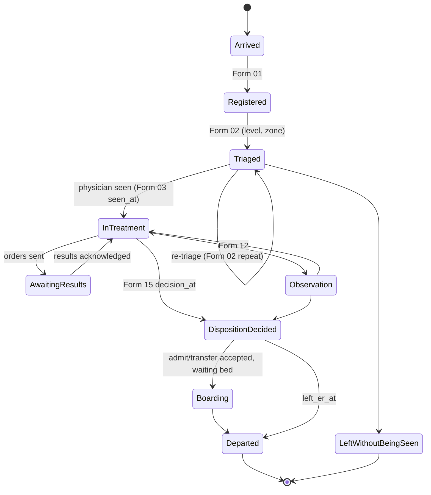
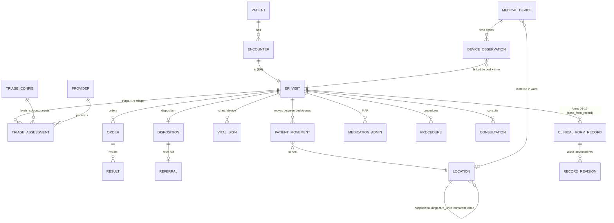
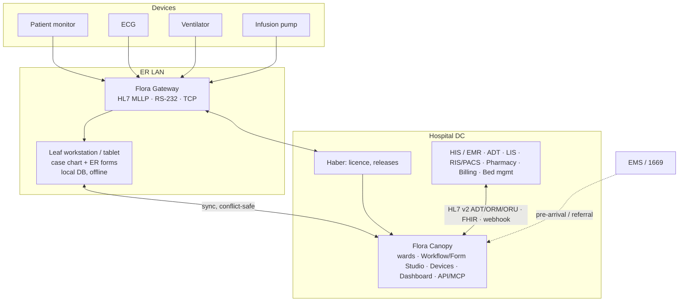

# EDIS Blueprint — ระบบสารสนเทศแผนกฉุกเฉิน (Emergency Department Information System) บน ESM Flora

**สถานะ:** ร่างสำหรับทบทวนกับทีมแพทย์/พยาบาล ER, กรรมการ HA และ IT ของโรงพยาบาล ก่อนใช้จัดทำ SRS/TOR
**ขอบเขตที่สร้างในระบบแล้ว (Canopy dev):**
- Care Unit **ER** มี 11 ห้อง 40 เตียง และทุกห้องมี zone
- Form Studio มี 15 ฟอร์ม `er_*` (สถานะ draft)
- Workflow Studio มี `er_emergency` (ค่าเริ่มต้นของ ward ER) และ `er_fast_track` (สถานะ draft)

**ไฟล์ที่เกี่ยวข้อง:**
- [`build_er_workflows.py`](build_er_workflows.py): สคริปต์สร้างฟอร์มและ workflow
- [`EDIS-Form-Specifications.md`](EDIS-Form-Specifications.md): field spec ทุกฟอร์ม
- `er_emergency.workflow.json` และ `er_fast_track.workflow.json`: ไฟล์สำหรับ import ข้ามโรงพยาบาล

> **หลักการสำคัญ:** เอกสารนี้ไม่สร้างเกณฑ์ทางคลินิกหรือข้อกำหนดทางกฎหมายขึ้นเอง ค่าใดที่แหล่งอ้างอิงไม่ตรงกันหรือไม่พบหลักฐาน จะติดป้าย **[ยืนยัน]** หมายถึงต้องยืนยันกับโรงพยาบาลหรือหน่วยงานที่เกี่ยวข้องก่อนใช้งานจริง

---

## 1. Thailand ER Standard Review

### 1.1 สิ่งที่ตรวจสอบได้จากแหล่งอ้างอิง

| หัวข้อ | สิ่งที่พบ | แหล่ง |
|---|---|---|
| ระบบคัดแยกระดับประเทศ | **MOPH ED Triage** ของกรมการแพทย์ กระทรวงสาธารณสุข แบ่งผู้ป่วย 5 ระดับ อ้างอิงเอกสาร *MOPH ED. Triage* (นนทบุรี: กรมการแพทย์, พ.ศ. 2561) | [Thai ED nursing study, he03](https://he03.tci-thaijo.org/index.php/ech/article/view/1968) |
| ที่มาของเกณฑ์ | พัฒนาจาก CTAS และ ESI v4 ปรับเป็น Thailand National Triage Guideline | [KBJ 2025](https://he01.tci-thaijo.org/index.php/KBJ/article/download/278347/188096/1302944), [LHIJ](https://he05.tci-thaijo.org/index.php/LHIJ/article/view/4621) |
| ชื่อระดับภาษาอังกฤษ | 1 Resuscitation, 2 Emergency/Emergent, 3 Urgent/Urgency, 4 Semi-urgent, 5 Non-urgent | ทั้งสองแหล่งข้างต้น |
| สีประจำระดับ | 1 **แดง**, 2 **ชมพู**, 3 **เหลือง**, 4 **เขียว**, 5 **ขาว** (บางแห่งใช้ขาว/ดำ) | [LHIJ](https://he05.tci-thaijo.org/index.php/LHIJ/article/download/4621/4965/8813) |
| ชื่อระดับภาษาไทย | **ไม่ตรงกันระหว่างแหล่ง** เช่น ระดับ 2 ใช้ทั้ง "ฉุกเฉินเร่งด่วนมาก" และ "ฉุกเฉินเร่งด่วน" ส่วนระดับ 5 ใช้ทั้ง "ผู้ป่วยทั่วไป" และ "ไม่ฉุกเฉิน" | KBJ vs LHIJ **[ยืนยัน]** |
| กรอบเวลาพบแพทย์ | **ไม่ตรงกันระหว่างแหล่ง** แหล่งหนึ่งใช้ ทันที / 10 / 30 / 60 / >60 นาที (อ้างเกณฑ์ของมหาวิทยาลัยมหิดล) อีกแหล่งระบุระดับ 3 ภายใน 2 ชม. และระดับ 4 ภายใน 3 ชม. | KBJ vs LHIJ **[ยืนยัน กับเอกสาร MOPH ED Triage ฉบับที่โรงพยาบาลใช้]** |
| UCEP / สพฉ. | นโยบาย "เจ็บป่วยฉุกเฉินวิกฤต มีสิทธิทุกที่" (UCEP) ของ สพฉ. และ สปสช. ใช้เกณฑ์ผู้ป่วยฉุกเฉินวิกฤตของ สพฉ. ซึ่งเป็น**ระบบแยกจาก MOPH ED Triage** | [InfoQuest](https://www.infoquest.co.th/?p=238478) — ตัวประกาศ กพฉ. ฉบับเต็ม **[ยืนยัน]** |
| HA, ICD-10/ICD-9-CM, SNOMED CT, PDPA, HL7 | เป็นกรอบที่ใช้ร่วมกับระบบสารสนเทศโรงพยาบาลทั่วไป EDIS อ้างถึงในส่วนข้อมูลและการเชื่อมต่อ แต่ไม่ได้ตีความข้อกำหนดเฉพาะของแต่ละมาตรฐาน | **[ยืนยันกับ HA/IT/DPO ของโรงพยาบาล]** |

### 1.2 ห้องแดง / ชมพู / เหลือง: ชื่อห้องหรือระดับความรุนแรง?

- **แดง/ชมพู/เหลือง/เขียว/ขาว เป็นสีของระดับ triage** (MOPH ED Triage ระดับ 1–5) ไม่ใช่ชื่อห้องตามมาตรฐานประเทศ
- หลายโรงพยาบาลตั้งชื่อ**พื้นที่**ตามสีของผู้ป่วยที่ดูแลเป็นหลัก เช่น "ห้องแดง" ใช้ resuscitate ระดับ 1 แต่การแบ่งและจำนวนพื้นที่**ขึ้นกับแต่ละโรงพยาบาล**
- ยังไม่พบเอกสารระดับประเทศที่กำหนดผังพื้นที่ ER ตามสี ([ผลการค้นหา](https://www.naewna.com/likesara/976870) พบเฉพาะคำอธิบายผู้ป่วยวิกฤตสีแดง) **[ยืนยันกับผังของโรงพยาบาล]**
- **ผลต่อการออกแบบระบบ:** แยกข้อมูล 3 มิติให้เป็นอิสระต่อกัน
  1. **Triage level** (1–5) เป็นของ encounter และ re-triage ได้
  2. **Patient category** (Trauma / Non-trauma) เป็นของ encounter
  3. **Physical area** คือห้อง/เตียง ซึ่งมี attribute **zone** ที่โรงพยาบาลตั้งชื่อเอง
  - ระบบไม่บังคับว่า level 2 ต้องอยู่ zone ชมพู ใช้แค่เป็นค่าแนะนำ (Assigned area)

---

## 2. ER Functional Area Matrix

Zone เป็น attribute ของห้อง (`canopy_location.zone`) และแก้ได้ที่ Canopy → Infrastructure → Wards, rooms & beds รายการด้านล่างคือที่สร้างไว้ใน ER (id 41)

| พื้นที่ (Room · zone) | วัตถุประสงค์ | ผู้ป่วยหลัก | อุปกรณ์หลัก | บุคลากร | แบบฟอร์มที่ใช้ | เตียง |
|---|---|---|---|---|---|---|
| Triage · *Triage* | คัดแยก วัดสัญญาณชีพ ส่งเข้าพื้นที่ | ทุกราย | เครื่องวัด VS, SpO₂, DTX | พยาบาล triage | 01, 02 | 2 |
| Resuscitation Room · *Resuscitation (Red)* | กู้ชีพ, airway, shock | ระดับ 1 (trauma/non-trauma) | monitor, defib, ventilator, airway cart, infusion pump | แพทย์ EP, พยาบาล 2+, RT | 03, 04, 06, 09, 10, 11 | 3 |
| Trauma Bay · *Trauma* | primary/secondary survey | trauma ระดับ 1–3 | monitor, FAST US, warmer, splint | trauma team | 05, 09, 10, 11 | 2 |
| Acute Care · *Acute (Pink)* | ผู้ป่วยเสี่ยงสูง | ระดับ 2 (เช่น ACS, stroke, sepsis) | monitor, ECG, infusion pump | แพทย์, พยาบาล | 03, 04, 10, 11 | 6 |
| Urgent Care · *Urgent (Yellow)* | ต้องใช้ทรัพยากร ≥ 2 | ระดับ 3 | monitor (บางเตียง) | แพทย์, พยาบาล | 03, 04, 10 | 8 |
| Fast Track · *Fast track* | ตรวจเร็ว, ใช้ทรัพยากรน้อย | ระดับ 4–5 | เก้าอี้ตรวจ | แพทย์, พยาบาล | workflow `er_fast_track` | 6 |
| Minor Procedure Room · *Procedure* | เย็บแผล, I&D, splint | ทุกระดับที่ stable | ชุดหัตถการ | แพทย์, พยาบาล | 09 | 1 |
| Isolation Room · *Isolation* | โรคติดต่อทางอากาศ/สัมผัส | ทุกระดับ | ห้องความดันลบ **[ยืนยันสเปกห้อง]** | ทีม IC | 04 | 2 |
| Pediatric Emergency · *Pediatric* | ผู้ป่วยเด็ก | ทุกระดับ | อุปกรณ์ขนาดเด็ก | แพทย์/พยาบาลเด็ก | 03, 04 | 3 |
| Psychiatric Safe Room · *Psychiatric* | ผู้ป่วยจิตเวช/เสี่ยงทำร้าย | ทุกระดับ | ห้องปลอดภัย | แพทย์, พยาบาล, รปภ. | 04 + Restraint (hospital-specific) | 1 |
| ER Observation Unit · *Observation* | สังเกตอาการไม่เกินเวลาที่โรงพยาบาลกำหนด **[ยืนยัน]** | stable รอผล/รอตัดสิน | monitor | พยาบาล | 12 | 6 |
| Ambulance receiving, Waiting, Referral/Transfer | จุดรับ EMS, รอตรวจ, รอส่งต่อ | — | — | — | 01, 14 | ไม่ใช่เตียง (ยังไม่สร้างในระบบ) |

**Trauma vs Non-trauma:** ใช้เป็น category ของผู้ป่วย (Form 01/02) ไม่ใช่ชื่อพื้นที่ Trauma Bay เป็นแค่พื้นที่หนึ่ง ผู้ป่วย trauma ระดับ 3 อาจอยู่ zone Yellow ก็ได้

---

## 3. ER Workflow Diagram

```mermaid
flowchart LR
  A[Arrival<br/>Walk-in · EMS 1669 · Referral · Internal] --> R[Form 01 Registration<br/>HN/VN/Encounter จาก HIS]
  R --> T[Form 02 Triage<br/>VS · GCS · Pain · Decision points · Level 1–5]
  T -->|Level 1| RES[Resuscitation (Red)<br/>Form 06 · 09]
  T -->|Trauma| TR[Trauma Bay<br/>Form 05]
  T -->|Level 2–3| AC[Acute / Urgent<br/>Form 03 · 04]
  T -->|Level 4–5| FT[Fast track<br/>workflow er_fast_track]
  RES & TR & AC & FT --> INV[Investigation<br/>Form 10 · LIS/RIS/ECG/POCT]
  INV --> TX[Treatment<br/>Chart: meds · IV · O₂ · VS จาก monitor<br/>Form 09 · 11 · 13]
  TX --> MON[Monitoring / Observation<br/>Form 12 · re-triage]
  MON --> DISP{Form 15 Disposition}
  DISP --> D1[Discharge] & D2[Admit] & D3[Transfer / Refer out<br/>Form 14] & D4[AMA] & D5[Death]
  DISP -.-> H[Form 16 SBAR handover]
```

ใน Flora ทั้งหมดนี้คือ **case เดียว** ของ Leaf ใน ward ER:
- **Vital signs (Form 07)** มาจากเครื่องมือแพทย์ผ่าน Gateway และบันทึกใน chart ของ case
- **MAR (Form 08)** ใช้ medication/IO record ของ case ที่มีอยู่แล้ว

จึงไม่มีการพิมพ์ข้อมูลเดียวกันซ้ำในฟอร์มอื่น

---

## 4. Patient State Machine



**การย้ายพื้นที่หลายครั้ง:** ทุกการย้ายเตียง/ห้องใน ER บันทึกเป็น **patient movement** พร้อม timestamp ได้แก่ เวลา, จากเตียง, ไปเตียง, zone และผู้ย้าย (ตาราง `er_patient_movement` ในข้อ 7) ส่วน re-triage เก็บเป็นประวัติใน Form 02 โดยไม่ทับค่าเดิม

**เวลาที่ใช้คำนวณ KPI:**
- `arrival_at` (01/02)
- `triaged_at` (02)
- `seen_at` (03)
- `decision_at` และ `left_er_at` (15)

---

## 5. Clinical Forms Catalog

| # | แบบฟอร์ม | ประเภท | ใน Flora | Workflow |
|---|---|---|---|---|
| 01 | ER Registration | Core | `er_registration` | ทั้งสอง |
| 02 | Emergency Triage Record | Core | `er_triage` | ทั้งสอง |
| 03 | Emergency Physician Assessment | Core | `er_physician_assessment` | ทั้งสอง |
| 04 | ER Nursing Assessment | Core | `er_nursing_assessment` | emergency |
| 05 | Trauma Assessment | Conditional (trauma) | `er_trauma_assessment` | emergency |
| 06 | Resuscitation Record | Conditional (arrest) | `er_resuscitation_record` | emergency |
| 07 | Vital Signs & Monitoring Chart | Core | **chart ของ case ใน Leaf** (รับข้อมูลจาก monitor ผ่าน Gateway) | — |
| 08 | Medication Administration Record | Core | **medication/IO record ของ case** (catalogue ยา/สารน้ำจาก Canopy) | — |
| 09 | Emergency Procedure Record | Conditional | `er_procedure_record` | ทั้งสอง |
| 10 | Investigation & Results | Conditional | `er_investigations` | ทั้งสอง |
| 11 | Clinical Pathway / Fast Track | Conditional | `er_fast_track_pathway` | emergency |
| 12 | ER Observation Chart | Conditional | `er_observation_chart` | emergency |
| 13 | Consultation Record | Conditional | `er_consultation` | emergency |
| 14 | Referral & Transfer Record | Conditional | `er_referral_transfer` | emergency |
| 15 | ER Discharge / Disposition Summary | Core | `er_disposition_summary` | ทั้งสอง |
| 16 | Emergency Nursing Handover (SBAR) | Core ตามนโยบาย | `er_nursing_handover` | emergency |
| 17 | ER Quality & Incident Record | Conditional | `er_quality_incident` | emergency |
| — | Consent (หัตถการ/รักษา) | Hospital-specific (มีผลทางกฎหมาย) | ใช้แบบฟอร์มของโรงพยาบาล **[ยืนยัน]** | — |
| — | Blood transfusion record | Conditional, hospital-specific | สร้างตามแบบของธนาคารเลือดโรงพยาบาล **[ยืนยัน]** | — |
| — | Physical restraint | Conditional, hospital-specific | ตามนโยบายโรงพยาบาล **[ยืนยัน]** | — |
| — | Death record / หนังสือรับรองการตาย | Conditional (มีผลทางกฎหมาย) | แบบฟอร์มทางการ **[ยืนยัน]** | — |
| — | นิติเวช / ใบชันสูตรบาดแผล / แจ้งความ | Conditional (มีผลทางกฎหมาย) | **[ยืนยัน]** | — |
| — | EMS handover (ITEMS/สพฉ.) | Conditional | ส่วน EMS ใน Form 01 + เอกสารของหน่วย EMS **[ยืนยัน]** | — |

ผมไม่ได้สร้างแบบฟอร์มที่มีผลทางกฎหมาย (consent, death, นิติเวช) เพราะต้องใช้แบบที่โรงพยาบาลหรือหน่วยงานกำหนด

---

## 6. Detailed Form Specifications

ดู [`EDIS-Form-Specifications.md`](EDIS-Form-Specifications.md) ซึ่ง generate จากนิยามฟอร์มจริงทุกครั้ง มี Field ID, label, data type, required, ช่วงค่า, ตัวเลือก, สูตร, เงื่อนไขการแสดง และ rule

**กฎทางคลินิกที่ฝังในระบบ** (เป็นสูตรมาตรฐานที่ตีพิมพ์แล้ว ไม่ใช่เกณฑ์ที่สร้างขึ้นเอง):
- **GCS** = E + V + M (V = T นับเป็น 1)
- **Suggested triage level:** ใช้ลำดับ decision point ของ ESI v4/MOPH ED Triage คือ ต้องช่วยชีวิตทันที → เสี่ยงสูง/สับสน/ปวดรุนแรง → จำนวนทรัพยากร → danger zone vital signs
  - พยาบาลเป็นผู้เลือกระดับจริงเสมอ
  - ถ้าเลือกไม่ตรงกับระดับที่ระบบแนะนำ ต้องใส่เหตุผล
  - เกณฑ์ danger zone เป็นตัวเลขที่โรงพยาบาลกำหนดเอง **[ยืนยัน]**
- **Revised Trauma Score** = 0.9368·GCSc + 0.7326·SBPc + 0.2908·RRc (Champion 1989)
- **Fast track (stroke/STEMI/sepsis/trauma):** บันทึกเฉพาะเวลา ส่วนเป้าหมายเวลาให้ตั้งจากเอกสาร pathway ของโรงพยาบาล **[ยืนยัน]**

ทดสอบแล้วด้วย formula engine ของระบบ: ระดับแนะนำตรงทั้ง 7 กรณี, rule เรื่อง override ทำงาน และ RTS สูงสุด = 7.8408

---

## 7. Entity Relationship Diagram



| กลุ่ม | Entity | สถานะใน Flora |
|---|---|---|
| **Master** | Patient, Provider (`auth_user` + role), Department/Location (`canopy_location` + **zone**), Bed, Medical Device (`canopy_medical_device`), Medication (`io_item_master`), Diagnosis/Procedure code | มีแล้ว ยกเว้น code tables ICD-10/ICD-9-CM ที่ต้องนำเข้าตามสิทธิ์การใช้ **[ยืนยัน]** |
| **Master (ใหม่)** | `er_triage_config`: ระดับ, ชื่อไทย, สี, เวลาเป้าหมาย, danger-zone, เกณฑ์พื้นที่ | **ต้องสร้าง** ให้โรงพยาบาลตั้งค่าได้ แทนการฝังค่าในระบบ |
| **Transactional** | Encounter/ER visit (`cases` + Form 01), Triage (Form 02), Assessments (03/04/05), Orders/Results (Form 10 จนกว่าจะเชื่อม LIS/RIS), MAR (medication record), Procedures (09), Consultation (13), Notes, Disposition (15), Referral (14) | ฟอร์มเก็บใน `case_form_record` และ Canopy `formdev_record` |
| **Transactional (ใหม่)** | `er_patient_movement`(case, from_bed, to_bed, zone, moved_at, moved_by) | **ต้องสร้าง** (ตอนนี้ case ผูกกับเตียงของ Leaf) |
| **Time-series** | Continuous VS, device observations, monitoring events, alarms | Gateway (`gateway_observation`) → Leaf chart และ Canopy (activity/events) |
| **Audit** | created/modified by/at, e-signature (signature field), amendment, audit trail | `field_versions`, `formdev_record_revision`, `case_change_log` มีแล้ว |

---

## 8. FHIR Resource Mapping

| ข้อมูล EDIS | FHIR R4 resource | หมายเหตุ |
|---|---|---|
| Patient (HN) | `Patient` (identifier HN, เลขประชาชนตาม PDPA) | |
| ER visit | `Encounter` (class `EMER`, `period`, `location[]` = ประวัติการย้ายเตียง) | |
| Arrival mode | `Encounter.hospitalization.admitSource` | |
| Triage level | `Observation` (ใช้ code ESI หรือ local code ของ MOPH ED Triage) **[ยืนยัน code system]** และ `Encounter.priority` | |
| Chief complaint | `Condition` (category encounter-diagnosis) หรือ `Encounter.reasonCode` | |
| Vital signs, GCS, pain | `Observation` (vital-signs profile, LOINC) | |
| Assessments / forms | `QuestionnaireResponse` (Questionnaire = Form Studio definition) | |
| Diagnosis ICD-10 | `Condition.code` | |
| Procedure ICD-9-CM | `Procedure` | |
| Orders / results | `ServiceRequest`, `DiagnosticReport`, `Observation`, `ImagingStudy` | |
| Medication | `MedicationRequest`, `MedicationAdministration` | |
| Consultation | `ServiceRequest` (category consult) และ `Communication` | |
| Referral | `ServiceRequest` (referral) และ `Task` | |
| Disposition | `Encounter.hospitalization.dischargeDisposition` | |
| Device data | `Device` และ `Observation.device` | |
| Location / zone | `Location` (`physicalType` = room/bed, zone เป็น extension) | |
| Audit / signature | `Provenance`, `AuditEvent` | |

Flora มี Public API (`/api/v1`) และ MCP อยู่แล้ว ส่วน FHIR facade เป็นงานในแผน (ข้อ 12)

---

## 9. System Architecture



**การเชื่อมต่อ:**
- **ADT/registration:** HL7 v2 (ADT^A04/A08) หรือ webhook ที่มีอยู่แล้ว (HL7 admission interface ของ Canopy) เข้าสู่ prepared admission แล้วไปที่ Leaf
- **LIS/RIS/PACS:** ORM/ORU หรือ FHIR `ServiceRequest`/`DiagnosticReport` ส่วน PACS ใช้ DICOM เฉพาะเปิดภาพ (deep link)
- **Pharmacy/Billing:** ส่งออกจาก medication record และ Billing ของ Canopy
- **Patient identity:** HN เป็น key หลัก จับคู่ encounter ด้วย VN/AN ส่วน device ระบุตัวด้วย gateway device ID และเตียง (Devices registry)
- **เวลา:** ทุก tier ใช้ NTP และ epoch ms
- **กันข้อมูลซ้ำ:** idempotency key และ version ในทุกเส้นทาง sync
- **ออกแบบให้ต่อ HIS เดิมได้:** EDIS ไม่แทนที่ HIS ใช้ HIS เป็น master ของ patient และ encounter

---

## 10. ER Dashboard Specification

| KPI / มุมมอง | นิยาม (จาก field) | ผู้ใช้ |
|---|---|---|
| ผู้ป่วยใน ER ตอนนี้ | case ACTIVE ใน ward ER | ทุกคน |
| แยกตาม triage level | ระดับล่าสุดจาก Form 02 รวม re-triage | แพทย์, พยาบาล |
| Trauma / Non-trauma | `category` | หัวหน้า |
| สถานะเตียง/ห้องตาม zone | เตียงใน ER, Leaf, case | พยาบาล |
| Door-to-triage | `triaged_at − arrival_at` | ผู้บริหาร |
| Door-to-doctor | `seen_at − arrival_at` แยกตามระดับ เทียบเป้าใน `er_triage_config` **[ยืนยันเป้า]** | ผู้บริหาร |
| ER length of stay | `left_er_at − arrival_at` | ผู้บริหาร |
| Boarding time | `left_er_at − decision_at` (admit/transfer) | ผู้บริหาร |
| Pending lab/imaging | Form 10 ที่ไม่มีผลหรือยังไม่ acknowledge | แพทย์ |
| Critical alerts | critical result ที่ยังไม่ ack, device alarm, ระดับ 1–2 ที่ยังไม่พบแพทย์ | แพทย์, พยาบาล |
| Pending admission/transfer | disposition = admit/transfer ที่ยังไม่ `left_er_at` | หัวหน้า |
| Fast-track performance | ช่วงเวลาใน Form 11 (door-to-CT, door-to-needle, door-to-ECG, time-to-antibiotics) | คณะกรรมการ PCT |

**การแสดงผล:**
- **Real-time:** ใช้ Central Charting/ICU-style overview ของ Canopy ปรับเป็น ER board
- **ย้อนหลัง:** ใช้ Report Studio/AI Studio query บน `formdev_record` และ `sync_case_index`

---

## 11. User Roles & Permissions

| บทบาท | สิทธิ์หลัก |
|---|---|
| พยาบาล triage | Form 01–02, re-triage, จัดเตียง/zone |
| พยาบาล ER | 04, 07–09, 12, 16, 17 และอ่านทุกฟอร์ม |
| แพทย์ ER / resident | 03, 05, 06, 09–11, 13–15 และสั่งการรักษา |
| แพทย์ที่ปรึกษา | 13 (ตอบ consult) อ่าน case ที่ได้รับปรึกษา |
| เจ้าหน้าที่เวชระเบียน/เปล | 01 (registration) และการย้ายผู้ป่วย |
| หัวหน้าพยาบาล/แพทย์ | dashboard, 17 (ทบทวน) และอนุมัติ amendment |
| ผู้บริหาร / คณะกรรมการคุณภาพ | dashboard และรายงาน ไม่เห็นข้อมูลระบุตัวตนเกินจำเป็น (PDPA) |
| Canopy admin | Form/Workflow Studio, ward/zone, devices และผู้ใช้ |

**การบังคับใช้สิทธิ์:**
- Flora ใช้ role, permission และ ward scope ที่มีอยู่แล้ว
- สิทธิ์ระดับฟอร์มใช้ `permission` ใน Form Studio
- ทุกการแก้ไขมี audit และ revision

---

## 12. Implementation Roadmap

**MVP** (ใช้ของที่สร้างไว้แล้ว)
1. ทีม ER ทบทวนฟอร์มใน Form Studio แล้ว publish จากนั้น Validate/Publish workflow `er_emergency` และ `er_fast_track`
2. ติดตั้ง Leaf/แท็บเล็ตต่อเตียงหรือต่อ zone ใน ward ER และผูก monitor เข้ากับ Gateway (Devices)
3. ตั้งค่า **[ยืนยัน]** ทุกข้อ ได้แก่ ชื่อระดับไทย, เวลาเป้าหมาย, danger zone และชื่อ zone
4. ใช้ HL7 admission webhook เพื่อรับ HN/VN จาก HIS
5. Release Canopy/Leaf ที่มี Workflow Studio ฝั่ง Leaf

**Phase 2**
- `er_triage_config`: ตั้งค่า triage และเป้าหมาย KPI ได้
- `er_patient_movement`: ย้ายเตียงใน ER โดยไม่เปิด case ใหม่
- ER tracking board แบบ real-time และ dashboard KPI ในข้อ 10

**Phase 3**
- LIS/RIS order–result (HL7 ORM/ORU, FHIR)
- e-signature ระดับกฎหมาย **[ยืนยัน]**
- FHIR facade
- EMS pre-arrival
- consent/restraint/blood forms ตามแบบของโรงพยาบาล

**Phase 4**
- Analytics, AI ช่วยสรุป disposition และตรวจความครบถ้วน
- Multi-site

**Resilience** (มีใน Flora แล้ว): Leaf ทำงาน offline ด้วย local DB, sync ที่ resolve conflict รายฟิลด์, gateway buffer (Kafka 72 ชม.), HTTPS, role/ward scope, audit trail และ backup
งานที่ต้องเพิ่มคือ DR plan ของโรงพยาบาล **[ยืนยัน]**

---

## แหล่งอ้างอิง
- Thai ED nursing study (MOPH ED Triage, กรมการแพทย์ 2561): https://he03.tci-thaijo.org/index.php/ech/article/view/1968
- กระบี่เวชสาร 2025, MOPH ED Triage และเกณฑ์เวลา: https://he01.tci-thaijo.org/index.php/KBJ/article/download/278347/188096/1302944
- โรงพยาบาลเมืองปาน, ระดับและสี: https://he05.tci-thaijo.org/index.php/LHIJ/article/view/4621
- UCEP (สพฉ./สปสช.): https://www.infoquest.co.th/?p=238478
- ผู้ป่วยวิกฤตสีแดง (ข่าว): https://www.naewna.com/likesara/976870
- Champion HR et al. *A revision of the Trauma Score.* J Trauma 1989 (RTS)
